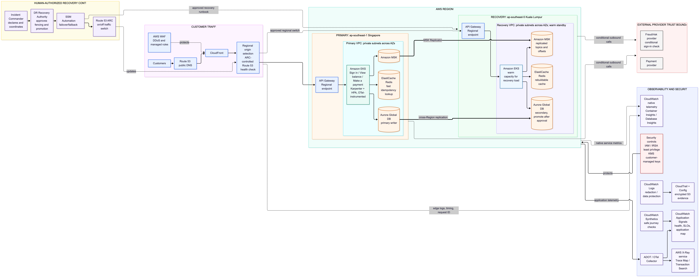

# CCOE SRE Assessment

## Cloud declaration

**Selected cloud: Amazon Web Services (AWS).** The target architecture uses
`ap-southeast-1` (Singapore) as the primary Region and `ap-southeast-5` (Malaysia -
Kuala Lumpur) as the secondary disaster-recovery Region. No Azure services are used.

## Executive brief

The design addresses slow customer-impact detection, retry storms, untested regional
recovery, and unclear reliability ownership. It measures customer journeys, protects
payment correctness, and makes recovery and ownership testable.

Targets: 99.99% availability per critical journey, 45-minute RTO, and five-minute RPO
for an agreed critical data set. Sign in, View balance, and Make a payment are candidate
journeys; confirm the real inventory and owners before baselining SLOs.

## Scenario findings

The scenario gives symptoms. Root causes remain hypotheses until incident evidence
confirms them.

| Finding | Working hypothesis | Initial response |
|---|---|---|
| Many alerts, slow detection | Component alerts may not show journey impact quickly. | Compare monitor coverage and MTTD with journey checks. |
| Retry storms, regional incidents | Cross-service retries may amplify dependency problems; the cause is unconfirmed. | Review incident evidence. Use a circuit breaker for an unhealthy dependency and bounded exponential backoff with jitter for safe transient retries. |
| DR untested end to end | Procedures and replication readiness are unproven. | Rehearse in representative staging/UAT, then validate production readiness separately. |
| Ownership disagreement | Cross-service journeys may lack one accountable owner. | Assign a journey owner while component teams retain service ownership. |

## Key decisions

| Decision | Why it matters | Proof or open item |
|---|---|---|
| 99.99% per critical journey over a rolling 365-day window | A service average can hide a failing customer journey. The request error budget is 0.01% of eligible requests; 52.56 minutes/year is the time-based equivalent. | Confirm journey scope, SLI rules, and latency/freshness objectives with Product and Risk. |
| Warm standby as the recovery baseline | A reduced live fleet lowers crisis-time provisioning risk for the 45-minute RTO. Backups remain necessary for corruption and deletion. | Timed end-to-end exercises must prove whether the five-minute RPO and 45-minute RTO are achievable. |
| Human-authorized recovery | A false failover can create split brain and inconsistent payment records. SSM orchestrates the approved runbook: fence the writer, promote and validate data, then use ARC to switch routing. | Rehearse approval, fencing, promotion, DNS convergence, and stop conditions in staging/UAT. |
| Ledger-backed payment safety | Provider timeouts can leave outcomes unknown. Preserve pending state, prevent duplicates, and reconcile before retry. | Confirm provider idempotency/status-query support and assign reconciliation ownership. |
| Instrument applications with OpenTelemetry (OTel). | AWS supports OTel through ADOT. Application Signals shows service health; the supported X-Ray service helps investigate traces. This avoids new instrumentation with X-Ray SDKs/daemon in maintenance mode. | Test trace continuity, CloudFront request-ID correlation, regional service availability, and cost. |
| Product/Platform ownership with SRE enablement | Reliability work needs accountable service owners and committed capacity. SRE enables and validates shared practices. | Confirm team capacity, service owners, toil baseline, and residual-risk acceptance with leadership. |

The task documents contain the detailed designs, trade-offs, validation steps, and
known limitations behind these decisions.

## Architecture at a glance

Singapore (`ap-southeast-1`) is the primary Region; Kuala Lumpur (`ap-southeast-5`) is
the warm recovery Region. The diagram above shows the traffic path, regional boundaries,
external providers, recovery controls, and AWS security/observability services.

Supporting diagrams

- [CUJ dependencies](./diagrams/01-cuj-dependency-map.png)
- [Observability](./diagrams/02-xray-observability-flow.png)
- [Resilience](./diagrams/03-resilience-state-machine.png)
- [Regional recovery](./diagrams/04-dr-failover-sequence.png)
- [Incident command](./diagrams/05-incident-command-flow.png)
- [90-day roadmap](./diagrams/06-90-day-roadmap-gantt.png)

## Assessment documents

1. [Reliability model](./01-reliability-model.md)
2. [Observability architecture](./02-observability-architecture.md)
3. [Resilience architecture](./03-resilience-architecture.md)
4. [Disaster and regional recovery](./04-dr-and-regional-recovery.md)
5. [Incident command](./05-incident-command.md)
6. [90-day roadmap](./06-90-day-roadmap.md)

## Assumptions and validation

- Confirm journey inventory, critical-data scope, provider contracts, latency objectives, and recovery clock with accountable owners.
- Validate service support, quotas, replication behavior, cost, and recovery capacity in both Regions. The Aurora engine remains undecided pending workload review.
- Confirm BNM RMiT retention, residency, access-review, and evidence requirements with Risk and Security.
- This submission covers architecture and operations. It includes no application, infrastructure, or YAML code.

## Sources

The design follows AWS Well-Architected guidance and provider documentation.

- **Observability:** [X-Ray SDK/daemon migration to OpenTelemetry](https://aws.amazon.com/blogs/mt/aws-x-ray-sdks-daemon-migration-to-opentelemetry/), [CloudWatch Application Signals](https://docs.aws.amazon.com/AmazonCloudWatch/latest/monitoring/CloudWatch-Application-Monitoring-Intro.html), [CloudWatch Synthetics](https://docs.aws.amazon.com/AmazonCloudWatch/latest/monitoring/CloudWatch_Synthetics_Canaries.html), [CloudWatch Logs data protection](https://docs.aws.amazon.com/AmazonCloudWatch/latest/logs/mask-sensitive-log-data.html).
- **Regional recovery and data:** [ARC routing controls](https://docs.aws.amazon.com/r53recovery/latest/dg/routing-control.html), [Systems Manager Automation](https://docs.aws.amazon.com/systems-manager/latest/userguide/automation-actions.html), [Aurora Global Database](https://docs.aws.amazon.com/AmazonRDS/latest/AuroraUserGuide/aurora-global-database.html), [MSK Replicator](https://docs.aws.amazon.com/msk/latest/developerguide/msk-replicator.html), [Resilience Hub policies](https://docs.aws.amazon.com/resilience-hub/latest/userguide/create-policy.html).
- **Platform and edge:** [EKS Kubernetes version support](https://docs.aws.amazon.com/eks/latest/userguide/kubernetes-versions.html), [CloudFront origin behavior](https://docs.aws.amazon.com/AmazonCloudFront/latest/DeveloperGuide/RequestAndResponseBehaviorCustomOrigin.html), [AWS WAF with CloudFront](https://docs.aws.amazon.com/waf/latest/developerguide/cloudfront.html), [API Gateway REST API tracing](https://docs.aws.amazon.com/apigateway/latest/developerguide/apigateway-xray.html).
- **Resilience options:** [AWS App Mesh end-of-support notice](https://docs.aws.amazon.com/app-mesh/latest/userguide/what-is-app-mesh.html), [Istio circuit breaking](https://istio.io/latest/docs/tasks/traffic-management/circuit-breaking/).

Verify current quotas, pricing, service lifecycle, and regional support before submission.

## AI disclosure

Generative AI assisted with organizing, drafting, and reviewing this assessment. I
reviewed and edited the content and remain responsible for validating the sources,
assumptions, architecture decisions, and final conclusions.
